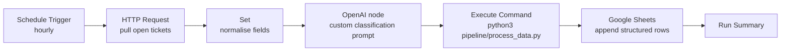

# Autonomous AI Task Execution Architecture

An autonomous workflow that turns messy operational records (support tickets,
lead lists, form dumps) into **structured, AI-enriched spreadsheets** —
without manual handling.

The architecture has two cooperating halves:

1. **Orchestration (n8n, on AWS EC2)** — a scheduled workflow pulls records
   from a data source, runs each record through a **custom AI prompt** for
   analytical classification (category, sentiment, priority, action
   required), executes the Python pipeline, and logs the results directly
   into a structured spreadsheet.
2. **Pipeline (Python, standard library only)** — extract → clean →
   AI-enrich → load. Runs standalone for local development and is invoked
   by n8n's Execute Command node in production.

## Architecture & data flow



```
┌──────────────────────── AWS EC2 (Docker) ────────────────────────┐
│  ┌──────────┐    ┌──────────────────────────────┐   ┌──────────┐ │
│  │   n8n    │───▶│ pipeline/process_data.py     │──▶│ Google   │ │
│  │ workflow │    │  extract → clean → AI-enrich │   │ Sheets   │ │
│  └──────────┘    │  prompts.yaml (4 templates)  │   └──────────┘ │
│                  └──────────────────────────────┘                │
└──────────────────────────────────────────────────────────────────┘
```

What the automation actually does (factually):

- Pulls records on a schedule — no manual export step.
- Cleans data programmatically: drops junk rows, deduplicates, normalises
  casing/whitespace, coerces types.
- Classifies every record with a **custom system prompt** (category /
  sentiment / priority / action-required) instead of human triage.
- Validates each classification with a QA self-check prompt before writing.
- Appends the enriched records to a spreadsheet and writes an audit
  `run_log.csv` (timestamp, records in/out, errors) for every run.

## Repository structure

```
autonomous-ai-task-execution/
├── n8n/
│   └── workflow.json          # importable n8n workflow export (7 nodes)
├── pipeline/
│   ├── process_data.py        # the ETL: extract → clean → enrich → load
│   ├── ai_prompts.py          # prompt rendering + deterministic local classifier
│   └── prompts.yaml           # 4 custom prompt templates (extraction,
│                              #   classification, summarisation, validation)
├── data/
│   └── sample_input.csv       # 63 messy sample ticket records
├── output/                    # generated CSVs (git-ignored)
│   ├── structured_report.csv  # one enriched row per clean record
│   └── run_log.csv            # audit log of every run
├── deploy/
│   ├── Dockerfile             # n8n image with the repo baked in
│   ├── docker-compose.yml     # n8n + data volumes stack
│   └── ec2-setup.md           # step-by-step EC2 deployment guide
├── requirements.txt           # standard library only — nothing to install
└── .gitignore
```

## Quick start (run the pipeline locally)

Requirements: Python 3.8+ and nothing else — the pipeline uses only the
standard library (`csv`, `argparse`, `logging`, `datetime`, `re`, `json`).

```bash
git clone https://github.com/<YOUR_USERNAME>/autonomous-ai-task-execution.git
cd autonomous-ai-task-execution

# run the full pipeline on the sample data
python3 pipeline/process_data.py --input data/sample_input.csv --output output/
```

Expected result: `output/structured_report.csv` (61 enriched rows — 63
records in, 1 junk row and 1 duplicate dropped) and an appended entry in
`output/run_log.csv`.

> **Note:** locally, the "AI analysis" step uses the deterministic
> rule-based classifier in `pipeline/ai_prompts.py`, which mirrors the
> decisions of the `classification` prompt in `prompts.yaml`. In
> production, the n8n **AI Classification** node sends the same rendered
> prompt to an LLM; `analyse_record_with_llm()` shows the equivalent
> production code path.

## Importing the workflow into n8n

1. Self-host n8n (see `deploy/`) or use n8n Cloud.
2. **Workflows → Import from File** → select `n8n/workflow.json`.
3. Add credentials:
   - `OpenAI account` — API key for the AI Classification node.
   - `Google Sheets account` — OAuth2, and set your sheet ID in the
     **Log to Spreadsheet** node (replace `YOUR_GOOGLE_SHEET_ID`).
   - Tickets API — bearer token for the **Pull Ticket Data** HTTP node;
     point it at your real source and adjust field mappings in
     **Normalise Fields**.
4. Review/activate — the Schedule Trigger runs the pipeline hourly.

The workflow is exported inactive (`"active": false`) so importing it
never starts executions before credentials are configured.

## EC2 deployment (summary)

Full step-by-step guide: [`deploy/ec2-setup.md`](deploy/ec2-setup.md).

1. Launch an Ubuntu 22.04 **t3.micro** EC2 instance; open ports 22 and 5678.
2. Install Docker + the compose plugin.
3. Clone this repo, create a `.env` with `N8N_BASIC_AUTH_PASSWORD` and
   `OPENAI_API_KEY`.
4. `docker compose -f deploy/docker-compose.yml up -d --build`.
5. Open `http://<EC2_PUBLIC_IP>:5678`, import `n8n/workflow.json`,
   add credentials, activate.

## Customising the prompts

The prompts are the "brains" of the system. Edit `pipeline/prompts.yaml`
to change behaviour — no code changes needed:

| Template | Purpose |
|---|---|
| `extraction` | Pull structured fields out of free-form text |
| `classification` | Tag category / sentiment / priority / action_required |
| `summarisation` | One-line operational summary per record |
| `validation` | QA self-check before a record is committed |

Rules for editing:

- Keep the `{{field_name}}` placeholders exactly as written — the pipeline
  (and the n8n node) substitutes them per record.
- The local classifier in `ai_prompts.py` implements the same decision
  rules as the `classification` prompt; if you change the allowed values
  or priority rules, update `_classify_text()` to match.
- In production, the n8n **AI Classification** node holds a copy of the
  classification prompt — keep it in sync with `prompts.yaml`.

## Tech stack

Python · n8n · Custom AI Prompts · AWS EC2 · Docker · Google Sheets
